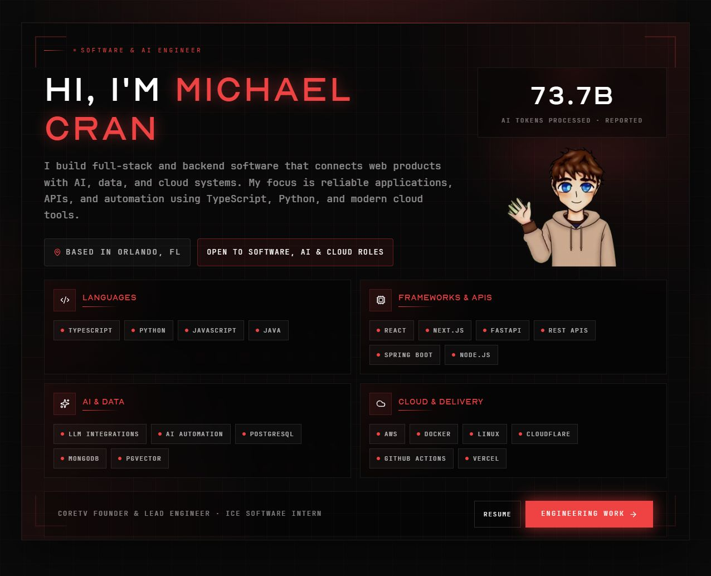

# Michael Cran

**Software & AI engineer · Full-stack applications · APIs & automation**

I build end-to-end software that connects product interfaces to APIs, data, AI integrations, and cloud services. My work includes Python and TypeScript backends, React applications, LLM-enabled workflows, and containerized delivery. I earned my B.S. in Computer Science at the University of Central Florida and founded **CoreTV**, where I lead engineering for CORE Business Technology.

[Engineering portfolio](https://mdcran.com/engineering) · [Resume](https://mdcran.com/resume) · [LinkedIn](https://www.linkedin.com/in/mdcran/) · [Contact](mailto:contact@mdcran.com)

## Selected public engineering work

| Project | What to review | Stack / focus |
| --- | --- | --- |
| [Coretex](https://github.com/MDCran/coretex) | Local-first workspace for AI agents, projects, and developer operations; shared desktop/web application layer and a backend service. Pre-1.0, with no published binary release yet. | TypeScript, React, Electron, PostgreSQL, Docker |
| [CoreTV.co platform](https://coretv.co/work/core-public-platform) | Public business technology platform for services, pricing, estimates, booking, contact, and client access. The case note describes six delivery stages with review points and links to the reusable AI contracts. | Next.js, React, TypeScript, AI integration, automation |
| [CORE Website](https://github.com/thecoreboys/coreboys-web) | Creator-group site with an interactive 3D hero, animated manifesto, six-person roster, and live Twitch status; [view the live site](https://thecoreboys.com). | Next.js 15, React 19, Three.js, GSAP, Twitch API |
| [Core AI](https://github.com/MDCran/core-ai) | Small provider-neutral package for isolating untrusted prompt input and authorizing metered chat, voice, and embedding requests. The public repository contains reusable contracts. | TypeScript, input isolation, usage authorization |
| [Health Tracker](https://github.com/MDCran/health-tracker) | Full-stack wellness platform for fitness, nutrition, sleep, vitals, and more. Includes AI food analysis, Google Drive backups, Spring Boot APIs, PostgreSQL, and PDF/CSV reports. | Java, Spring Boot, Next.js, PostgreSQL, Docker |
| [Portfolio application](https://github.com/MDCran/mdcran-portfolio) | This live website's source: content management, public APIs, streaming AI chat, voice features, analytics, screen-reader support, and custom themes. | Next.js, React, TypeScript, MongoDB |
| [Army Reserve — Mercury](https://www.ucf.edu/news/ucf-students-support-u-s-military-with-new-technology/) | U.S. Army Reserve forms and operations platform developed with NSIN; I contributed to the web/mobile product and led a React and React Native UI overhaul, with public UCF project coverage. | React, React Native, mobile UX, operations workflows |
| [ICE website](https://github.com/MDCran/ice-website) | Website development for International Computer Exchange, an enterprise infrastructure and disaster recovery company. | Web development, enterprise communication |

## Background

- **Founder, Software & AI Engineer — CoreTV:** websites, AI reception, business systems, and workflow automation.
- **Software Engineer Intern — International Computer Exchange:** enterprise infrastructure and disaster recovery systems.
- **Army Reserve — Mercury project:** secure serverless web and mobile application developed in partnership with the U.S. Army Reserve.
- **Creator infrastructure:** custom software and content pipelines for Minecraft creators and communities.

See my [resume](https://mdcran.com/resume) for dates, responsibilities, education, and certifications.

## Skills & tools

- **Languages & fundamentals:** Java, Python, C/C++, C#, JavaScript, TypeScript, HTML/CSS, algorithm design.
- **Frameworks & APIs:** React, Next.js, Angular, Node.js, Expo, Tailwind CSS, FastAPI, RESTful APIs, server architecture.
- **AI & data:** CUDA, Triton, LLM integration, AI automation, PostgreSQL, MongoDB/NoSQL, pgvector, pandas, NumPy, Matplotlib, OpenCV.
- **Cloud, delivery & tools:** AWS (EC2, S3, RDS, IAM, SAM CLI, Lambda), Docker, Git, Nginx, Ubuntu/Linux, GitHub Actions, CI/CD, Cloudflare, Vercel/Netlify, n8n/Zapier, Jira/Confluence, Agile/Scrum, Cursor, RenderDoc.

My [engineering portfolio](https://mdcran.com/engineering) connects these areas to public code, project write-ups, screenshots, and demos. Client implementations and production credentials stay private.

Based in **Orlando, Florida**. Open to software, applied AI, full-stack, backend, and cloud engineering opportunities.
